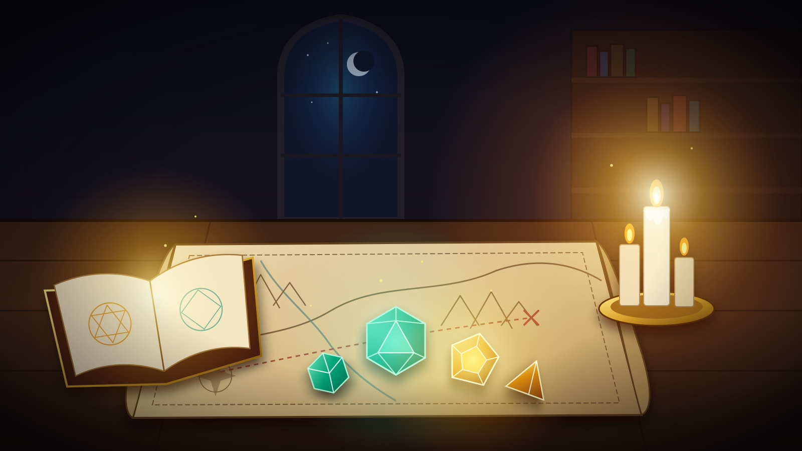
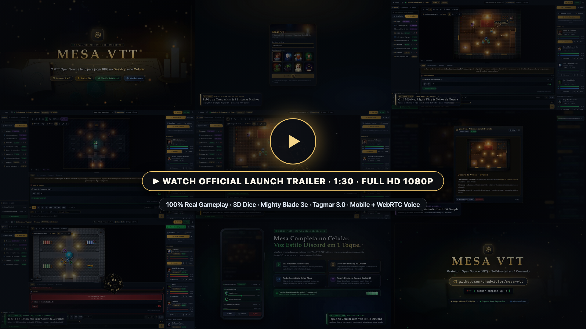
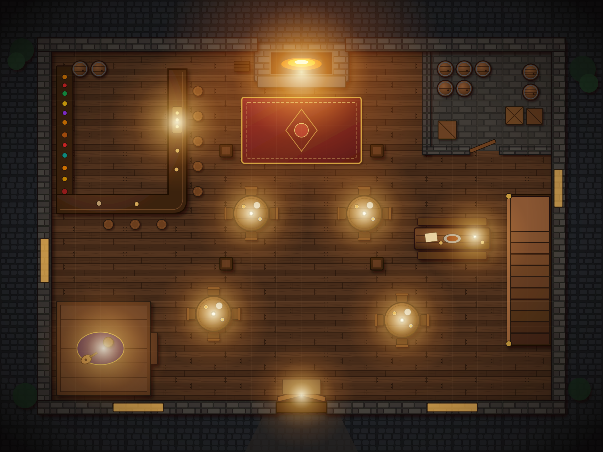
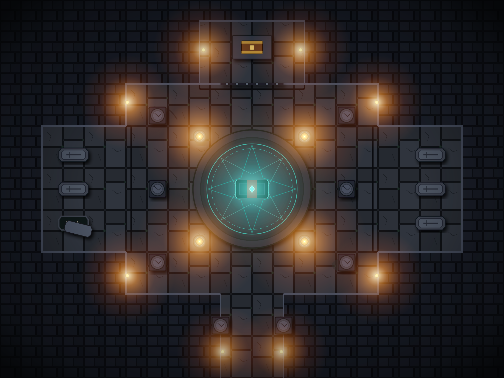
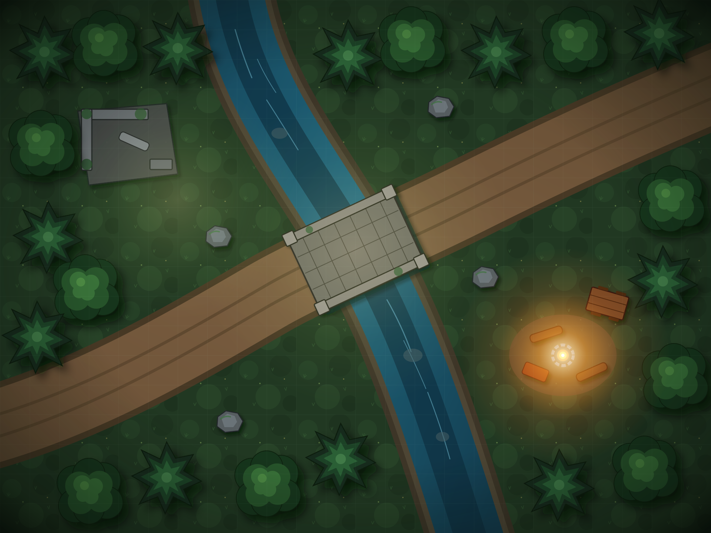
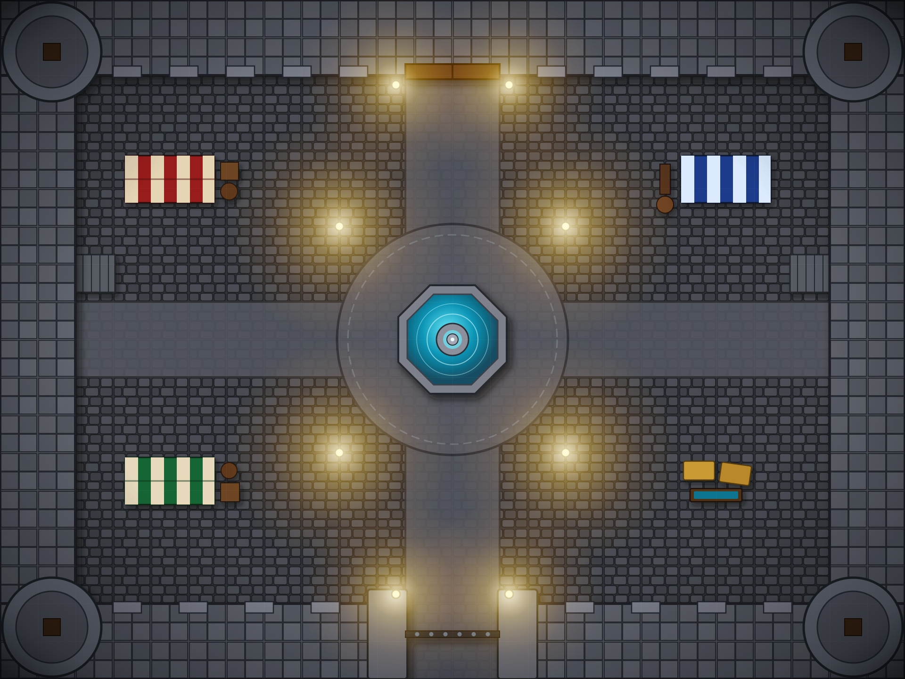
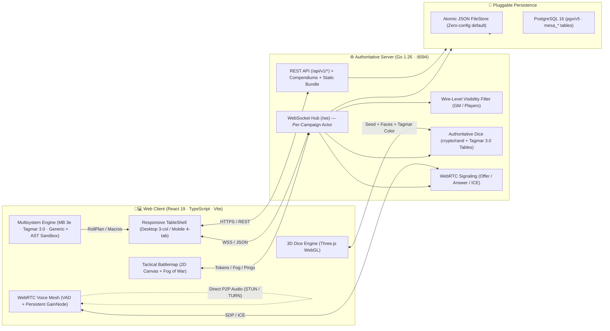

<div align="center">



# 🎲 Mesa VTT

**A free, open-source, mobile-first multisystem Virtual Tabletop (VTT) for playing tabletop RPGs online — shipping with full Mighty Blade 3rd Edition and Tagmar 3.0 + Expansions automation.**

[🇧🇷 Ler em Português](README.md) · 🇺🇸 **English**

[](LICENSE)
[](data/tagmar/LICENSE.md)
[](https://go.dev/)
[](https://react.dev/)
[](https://www.typescriptlang.org/)
[](https://threejs.org/)
[](#-key-features)
[](#-why-mesa-vtt)

[Trailer](#-official-trailer-real-gameplay) •
[Why Mesa VTT?](#-why-mesa-vtt) •
[Features](#-key-features) •
[Built-in Systems](#-built-in-systems) •
[Art Gallery](#-built-in-art-gallery) •
[Architecture](#-architecture) •
[Quick Start](#-quick-start) •
[Roadmap](#-roadmap) •
[Licensing](#-licensing)

</div>

---

## 🎬 Official Trailer (Real Gameplay)

<div align="center">

[](https://github.com/chadvictor/mesa-vtt/releases/download/v0.1.0/mesa-vtt-trailer.mp4)

**[▶ Watch / Download 1080p Full HD Trailer (`mesa-vtt-trailer.mp4`)](https://github.com/chadvictor/mesa-vtt/releases/download/v0.1.0/mesa-vtt-trailer.mp4)** · **[📦 Release `v0.1.0`](https://github.com/chadvictor/mesa-vtt/releases/tag/v0.1.0)**

*100% live gameplay captured directly from Mesa VTT: Multisystem Lobby, Tactical Battlemap with Ruler/Pings/Fog of War, Three.js 3D Dice, Automated Mighty Blade 3rd Edition, Firecast-style Library with GM/Player permissions & zero-`eval` Macros, Tagmar 3.0 + Expansions (color-coded `1d20` Resolution Table), and Mobile-First Gameplay with live Discord-style WebRTC Voice.*

</div>

---

## ✨ Why Mesa VTT?

Playing tabletop RPGs online with friends shouldn't mean wrestling with desktop-only VTTs that break on phones, juggling separate Discord calls, scattering character sheets across PDFs, or locking campaigns behind pricey monthly subscriptions.

**Mesa VTT** brings everything a tabletop group needs into a single fast, free, self-hostable web app built from day one for **both smartphones and desktop browsers**:

- **Inspired by RRPG Firecast:** nested campaign folders and Markdown handouts with true GM/player permissions, rich roleplay chat (In-Character, Out-of-Character, Narration, Whispers), and deep love for landmark Brazilian open tabletop RPGs (**Mighty Blade 3rd Edition** and **Tagmar 3.0**).
- **Tactical power of Foundry VTT:** interactive battlemap canvas with Fog of War, tokens with live HP/MP or EH/EF bars, distance ruler, synchronized pings, real-time 3D dice, and a deeply scriptable multisystem engine.
- **Discord-style built-in voice:** 1-tap WebRTC voice channels that stay mounted at the top of the table — switching between Chat, Map, Sheets, and Library on a phone **never drops your call**.

Everything ships as a **single lightweight Go 1.26 binary / Docker image** that runs out of the box with **zero external database** (atomic JSON file store) or scales effortlessly onto **PostgreSQL**.

---

## 🚀 Key Features

| Pillar | Included Out of the Box |
|---|---|
| 🎙️ **Discord-Style Integrated Voice (WebRTC + VAD)** | Low-latency P2P audio mesh with zero heavy media-server overhead. **1-tap** join, mute, and deafen; Web Audio Voice Activity Detection (**VAD**) with a **glowing emerald ring** around active speakers; per-peer volume sliders; graceful Listen-Only fallback when a mic is unavailable; and **persistent audio** across mobile tabs. |
| 🎲 **Real-Time 3D Dice (Three.js)** | Procedural polyhedra (`d4`, `d6`, `d8`, `d10`, `d12`, `d20`, and `d100`) with crisp Canvas textures and deterministic pre-simulated physics. The Go server rolls faces authoritatively via **`crypto/rand`** so every player sees synchronized 3D dice land strictly on the real values — with custom visual feedback for **Criticals**, **Fumbles**, and **Tagmar 3.0's color-coded Resolution Table** (plus graceful WebGL and `prefers-reduced-motion` fallback). |
| 🗺️ **Tactical Battlemap + Fog of War** | High-DPI HTML5 Canvas built for both mouse and touch (**pinch-to-zoom**, 1-finger pan/token drag), configurable grid (`1.5m`/square) with snap-to-grid, circular portrait tokens with synced bars (`PV`/`PM` or `EH`/`EF`) & condition badges, **secret GM layer** (`layer: "gm"`), **Fog of War** reveal/hide brush, distance ruler, synchronized pings, **4 built-in SVG maps**, plus custom image uploads (PNG/JPEG/WebP). |
| 📚 **Firecast-Style Library with Real Permissions** | Nested folders, lore notes, and Markdown handouts with illustrations. Visibility tiers (**GM Only**, **All Players**, or **Specific Players**) are **enforced on the Go server at the wire level** — hidden GM notes, secret tokens, hidden scenes, and private rolls are stripped before serialization and never reach unauthorized clients. |
| 🧩 **Zero-`eval` Scriptable Multisystem Engine** | Clean modular architecture under [`systems/`](systems/) shipping with **3 built-in systems** (**Mighty Blade 3rd Edition**, **Tagmar 3.0 + Expansions**, and **Generic RPG**), powered by a pure-TypeScript AST expression & macro sandbox ([`systems/sandbox.ts`](systems/sandbox.ts)) that is 100% strict-CSP compliant (`script-src 'self'`), blocks prototype pollution, and caps execution steps. |
| ⚔️ **Combat Tracker & Interactive Chat** | Round-based initiative tracker (`2d6` for Mighty Blade, `1d10 + AGI` for Tagmar 3.0, freeform for Generic), rich chat modes (**IC**, **OOC**, **Narration**, **Whisper**), `/r 1d20 col N` chat rolls, and **Interactive Roll Cards** with 1-click actions (*Apply Damage EH→EF or Direct-to-EF*, *Heal*, *Spend Mana/Karma*, *Roll RF/RM*, *Apply Condition*). |

---

## 🎮 Built-in Systems

### ⚔️ Mighty Blade 3rd Edition (`mighty-blade-3e`) — Complete & Automated

A complete, deeply automated implementation of **Mighty Blade 3rd Edition (3.5)** — Brazil's beloved open-distribution medieval fantasy RPG set in the world of **Drakon**:

<table>
  <thead>
    <tr>
      <th align="center">16</th>
      <th align="center">14</th>
      <th align="center">18</th>
      <th align="center">169</th>
      <th align="center">110</th>
      <th align="center">115</th>
      <th align="center">42</th>
    </tr>
  </thead>
  <tbody>
    <tr>
      <td align="center">Races</td>
      <td align="center">Classes</td>
      <td align="center">Conditions</td>
      <td align="center">Abilities</td>
      <td align="center">Spells<br/><sub>(11 Paths)</sub></td>
      <td align="center">Equipment<br/><sub>(40 weapons · 20 armor/shields · 55 gear)</sub></td>
      <td align="center">Bestiary<br/><sub>Creatures</sub></td>
    </tr>
  </tbody>
</table>

- **5-Step Hero Creation Wizard:** Race → Class → Attribute Point Distribution (live derived-stat preview) → Starting Abilities & Spells → Identity & Portrait.
- **Full Rules Automation:** `PV` (HP), `PM` (Mana), `Bloqueio` (Block), `Esquiva` (Dodge), Effective Defense, `Determinação` (Resolve), Movement (`1.5m` grid squares), Encumbrance tiers, and **FN (Required Strength)** checks on weapons, armor, and shields.
- **1-Click Combat & Spellcasting:** `2d6 + Attribute` rolls with automatic **Critical (`6+6`)** and **Critical Fumble (`1+1`)** detection, automatic **PM** tracking across all 11 Paths of Magic, and 1-click bestiary spawning.
- **Ready-to-Play Seeded Campaign:** **`DRAKON`** (*"Crônicas de Drakon — A Estalagem do Javali Dourado"*).

> **Attribution:** **Mighty Blade 3rd Edition** was created by **Tiago Junges** (with co-authors Domênico Gay and Luciano Abel) and published by **Coisinha Verde** as an official free-distribution Brazilian tabletop RPG.

---

### 🛡️ Tagmar 3.0 + Expansions (`tagmar-3`) — Complete & Automated

Authentic, full-featured native automation for Brazil's pioneering 1991 open-source medieval fantasy RPG — **Tagmar 3.0 and official expansions by Projeto Tagmar** (*Livro de Regras*, *Livro de Magias*, *Livro das Ordens Sacerdotais*, *Livro das Criaturas*, *Equipment & Magic Relics*, and *Aventuras nas Terras Selvagens*):

<table>
  <thead>
    <tr>
      <th align="center">15</th>
      <th align="center">42</th>
      <th align="center">24</th>
      <th align="center">103</th>
      <th align="center">187</th>
      <th align="center">148</th>
      <th align="center">48</th>
    </tr>
  </thead>
  <tbody>
    <tr>
      <td align="center">Races<br/><sub>(6 Core · 9 Expansions)</sub></td>
      <td align="center">Professions & Specs<br/><sub>(6 Core · 36 incl. 13 Orders)</sub></td>
      <td align="center">Automated<br/><sub>Conditions</sub></td>
      <td align="center">Skills & Tech.<br/><sub>(66 Skills · 37 Combat)</sub></td>
      <td align="center">Spells<br/><sub>(Colleges, Orders & Paths)</sub></td>
      <td align="center">Gear & Relics<br/><sub>(52 weapons · 28 armor · 68 items)</sub></td>
      <td align="center">Creatures<br/><sub>(Livro das Criaturas)</sub></td>
    </tr>
  </tbody>
</table>

- **Color-Coded `1d20` Resolution Table (Columns `-7` to `20+`):** both the Go server and TypeScript engine resolve every `1d20` roll against the exact official Tagmar 3.0 table — **Erro Crítico (Fumble)**, **Falha (Failure)**, **Verde (25%)**, **Amarelo (50%)**, **Laranja (75%)**, **Vermelho (100%)**, and **Azul — Critical (125% · Direct to EF!)**, including the official overflow rule above Column 20 and an interactive lookup table in the compendium.
- **Resistance Table (`RF` & `RM`):** complete `460`-cell resistance matrix (`FD -2..20` × `FA 1..20`) with 1-tap sheet rolls and automatic spell follow-up prompts on Roll Cards.
- **Authentic `EH → Absorção → EF` Damage Pipeline:** normal hits drain **Heroic Energy (`EH`)** first, overflow through armor/shield/helmet **Absorption**, and only then strike **Physical Energy (`EF`)** — automatically applying **Inconsciente** (`EF ≤ 0`), **Agonizando** (`EF < 0`), and **Morto** (`EF ≤ -15`); **Blue Criticals** bypass `EH` and normal absorption straight into `EF`!
- **5-Step Creation Wizard + Full Sheet:** progressive attribute point-buy (`15` pts / `16` pts Human), 6 attributes (`INT`, `AUR`, `CAR`, `FOR`, `FIS`, `AGI`), mystic `Karma` `(AUR + 1) × (Stage + 1)`, `DA`/`DP`/`Absorção`, `VB`, `1d10 + AGI` initiative, `MO`/`MP`/`MC` currency, Stage `1–20` advancement with Stage-5 Specialization/Order/College unlock, and 1-click bestiary summoning onto the map.
- **Ready-to-Play Seeded Campaign:** **`TAGMAR`** (*"Crônicas de Tagmar — Fronteira de Verrogar"*), featuring 4 pre-built Stage-1 heroes (*Kael de Verrogar*, *Aelindra*, *Thorgar*, *Liriel*), 2 tactical maps, GM-secret ambush tokens & notes, and pre-built Tagmar macros.

> **Tagmar Compendium License & Attribution:** Content under [`data/tagmar/`](data/tagmar/) is licensed under **Projeto Tagmar's** official **Creative Commons Attribution-NonCommercial-ShareAlike 3.0 Brazil (`CC BY-NC-SA 3.0 BR`)** license (<https://www.tagmar.com.br>), crediting Marcelo Rodrigues, Ygor Moraes Esteves da Silva, Julio Augusto Cezar Junior, Leonardo Nahoum Pache de Faria, and the Projeto Tagmar community. See [`data/tagmar/LICENSE.md`](data/tagmar/LICENSE.md) and [`NOTICE.md`](NOTICE.md).

---

### 🧩 Generic RPG (`generic-rpg`) — Freeform & Customizable

Playing another RPG? The built-in **Generic RPG** engine supports custom attributes, arbitrary resource bars, freeform dice expressions (`1d20`, `3d6`, `2d10`, `1d100`, `kh`/`kl`), and full sandboxed macros.

---

## 🖼️ Built-in Art Gallery

Mesa VTT bundles **17 bespoke, resolution-independent SVG assets** (hero banner, **4 tactical battlemaps** at `1920×1440` on a `24×18` grid, **8 hero/GM portraits**, and **4 monster tokens**) with zero external CDN dependencies — plus built-in upload support for your own maps and portraits.

| The Golden Boar Inn (`tavern.svg`) | Crypt of the Ancients (`dungeon-crypt.svg`) |
| :---: | :---: |
|  |  |
| *Cozy medieval tavern with an L-shaped bar, roaring hearth, bard stage, barrel cellar, and mezzanine stairs (`24×18`).* | *Weathered stone crypt with a central arcane ritual altar, glowing braziers, sarcophagus alcoves, and gated reliquary — built for Fog of War (`24×18`).* |

| Dark Forest Road (`forest-road.svg`) | Fortress / Castle Courtyard (`castle-courtyard.svg`) |
| :---: | :---: |
|  |  |
| *Winding dirt road, stone bridge over a clear creek, moss-covered ruins, and a roadside camp ripe for ambushes (`24×18`).* | *Walled medieval citadel courtyard with cobblestone paving, octagonal fountain, market stalls, watchtowers, and drawbridge (`24×18`).* |

---

## 🏗️ Architecture



See [`docs/ARCHITECTURE.md`](docs/ARCHITECTURE.md) for the complete WebSocket envelope reference, domain models, and security invariants.

---

## ⚡ Quick Start

### 1. Docker / Docker Compose (Recommended — One-Liner on `:8094`)

```bash
git clone https://github.com/chadvictor/mesa-vtt.git
cd mesa-vtt

# Launch with zero-config persistent JSON storage
docker compose up -d
```

Open **`http://localhost:8094`** in your browser!

Want **PostgreSQL** instead of the JSON file store (great for larger self-hosted communities)?

```bash
docker compose --profile postgres up -d
```

Or build and run the standalone multi-stage `distroless` image directly:

```bash
docker build -t mesa-vtt .
docker run --rm -p 8094:8094 mesa-vtt
```

### 2. Local Development (Go 1.26 + Node 22 / Vite)

**Terminal 1 — Authoritative Go Server (`:8094`):**

```bash
# Local auth enabled by default + auto-seeds DRAKON and TAGMAR demo campaigns
LISTEN_ADDRESS=:8094 go run ./server/cmd/server
```

**Terminal 2 — React + Vite Client (`:3104`, proxies `/api` & `/ws` → `:8094`):**

```bash
cd client
npm install
npm run dev
```

Visit **`http://localhost:3104`** on desktop or via your LAN IP on a phone.

### 3. Seeded Demo Campaigns Walkthrough (`DRAKON` & `TAGMAR`)

On first startup with an empty store, Mesa VTT automatically seeds **two complete ready-to-play adventures**:

- **`DRAKON`** (*Mighty Blade 3rd Edition*) — *"Crônicas de Drakon — A Estalagem do Javali Dourado"* (4 heroes, 2 battlemaps with Fog of War, GM secrets, and `2d6` macros).
- **`TAGMAR`** (*Tagmar 3.0 + Expansions*) — *"Crônicas de Tagmar — Fronteira de Verrogar"* (4 Stage-1 heroes — *Kael de Verrogar*, *Aelindra*, *Thorgar*, *Liriel* — Captain Brenno, Verrogar Fortress & Dark Forest Road scenes, GM-layer ambush monsters, lore folders, and Tagmar Resolution / RF / RM macros).

1. **Enter the Lobby:** pick a display name in local quick login and open either **`DRAKON`** or **`TAGMAR`** from the hero showcase (or click **Join by Code**). Join as **GM** or **Player**.
2. **Verify Wire-Level Visibility:** open a second private/incognito window as a **Player** alongside your **GM** window — GM-only folders (`Segredos do Mestre`), hidden ambush sheets, and GM-layer tokens are stripped on the Go server and never transmitted to players.
3. **Roll 3D Dice & Automated Actions:** in **`TAGMAR`**, trigger Kael's Longsword attack or Aelindra's *Bola de Fogo* to see the color-coded `1d20` Resolution Table banner, Karma deduction, `RF`/`RM` resistance follow-ups, and 1-click `EH → Absorção → EF` (or Blue Critical direct-to-`EF`) damage application synced live to map tokens.
4. **Test Built-in Voice:** click **"Entrar na Voz"** in the persistent voice bar to join **Mesa Principal** or hop into **Sussurro do Mestre** — switching between Map, Chat, Sheets, and Library never drops your call.

### 4. Mobile Voice Notes (HTTPS & TURN)

- **HTTPS required on phones:** mobile browsers (iOS Safari and Android Chrome) require a secure context (**HTTPS**) for `getUserMedia` microphone access outside `localhost`. When hosting for remote or LAN mobile players, put Mesa VTT behind an HTTPS reverse proxy (**Caddy**, **Nginx**, **Traefik**, or **Cloudflare Tunnel**) and set `APP_ORIGIN=https://your-domain.com`.
- **Default STUN + Optional TURN:** out of the box, Mesa VTT uses public Google STUN servers (`stun.l.google.com:19302`). For players behind strict carrier-grade NAT (4G/5G/corporate firewalls), add a **TURN** server (e.g., `coturn`) via `MESA_ICE_SERVERS`:

```bash
MESA_ICE_SERVERS='[{"urls":"stun:stun.l.google.com:19302"},{"urls":"turn:turn.yourdomain.com:3478","username":"mesa","credential":"strong-secret"}]'
```

<details>
<summary>📋 Key environment variables (see <code>.env.example</code>)</summary>

| Variable | Default | Description |
|---|---|---|
| `LISTEN_ADDRESS` | `:8094` | HTTP/WebSocket bind address. |
| `AUTH_MODE` | `local` | `local` (built-in quick login) or `sso` (external ticket authentication). |
| `DATABASE_URL` | *(empty)* | Optional PostgreSQL DSN. Falls back to atomic JSON FileStore when unset. |
| `MESA_DATA_FILE` | `.mesa-vtt-data.json` | JSON file path when running without PostgreSQL. |
| `SESSION_SECRET` | *(ephemeral random)* | HMAC-SHA256 signing key for session tokens (set a persistent value in production). |
| `APP_ORIGIN` | `http://localhost:8094` | Allowed origin for CORS and WebSocket origin checks in production. |
| `MESA_ICE_SERVERS` | Google STUN | JSON array of WebRTC STUN/TURN servers served to clients. |
| `STATIC_DIR` | *(empty / `/app/web` in Docker)* | Directory holding the compiled frontend (`client/dist`) served by the Go binary. |
| `GEMINI_API_KEY` | *(optional)* | Optional API key for AI-assisted map/portrait generation when enabled. |

</details>

---

## 🗺️ Roadmap

- [x] 🇧🇷 **Mighty Blade 3rd Edition (`mighty-blade-3e`)** — Full compendium, 5-step wizard, `2d6` Critical/Fumble automation, FN checks, and **`DRAKON`** demo campaign.
- [x] 🇧🇷 **Tagmar 3.0 + Expansions (`tagmar-3`)** — Color-coded `1d20` Resolution Table (`-7..20+`), `RF/RM` Resistance Table, `EH → Absorção → EF` + Critical direct-to-`EF`, 15 races, 42 professions/orders, 187 spells, 148 items/relics, 48 creatures, and **`TAGMAR`** demo campaign.
- [ ] 📦 **Next Open & Community System Packs** — **Old Dragon 2e**, **3D&T**, **D&D 5e SRD / Pathfinder 2e (ORC)**, `d100` investigative games, and narrative RPGs (use `systems/tagmar/` as a live reference via [`docs/CREATING_SYSTEMS.md`](docs/CREATING_SYSTEMS.md)!).
- [ ] 🕯️ **Dynamic Lighting & Line of Sight (LoS)** — Light-blocking walls, token light sources, and automatic racial darkvision.
- [ ] 🎵 **Synchronized Audio Ambience & Soundboard** — Tavern loops, dungeon ambience, weather, and GM-triggered SFX.
- [ ] 📱 **Installable Mobile PWA** — Home-screen app experience on Android/iOS, turn notifications, and offline sheet/compendium browsing.
- [ ] 🔌 **Community Plugin & Asset Registry** — Shareable packs for RPG systems, SVG battlemaps, token art, and macro libraries.

---

## 🤝 Contributing

Contributions of all kinds are welcome — Go backend, React/Three.js frontend, new RPG system modules, SVG battlemaps, translations, and bug reports!

- Read **[`CONTRIBUTING.md`](CONTRIBUTING.md)** for local dev setup, test commands, security invariants, and PR standards.
- Building a new RPG system? Follow **[`docs/CREATING_SYSTEMS.md`](docs/CREATING_SYSTEMS.md)** (featuring `systems/tagmar/` as a real production reference implementation!).
- Deep-dive into the architecture in **[`docs/ARCHITECTURE.md`](docs/ARCHITECTURE.md)**.

---

## 📄 Licensing

Mesa VTT separates the open-source VTT software from third-party RPG compendium datasets under `data/`:

- **Mesa VTT Software (Go server, Web/Mobile client, `systems/` engine, and original SVG art):** released under the **MIT License** — see [`LICENSE`](LICENSE).
- **Tagmar 3.0 RPG Compendium (`data/tagmar/`):** licensed under **Creative Commons Attribution-NonCommercial-ShareAlike 3.0 Brazil (`CC BY-NC-SA 3.0 BR`)** per **Projeto Tagmar** (<https://www.tagmar.com.br>) — see [`data/tagmar/LICENSE.md`](data/tagmar/LICENSE.md) and [`NOTICE.md`](NOTICE.md). Commercial derivatives of the MIT software must remove or replace `data/tagmar/`.
- **Mighty Blade 3rd Edition Data (`data/mighty-blade/`):** community tribute to the free-distribution Brazilian RPG created by Tiago Junges / Coisinha Verde — see [`NOTICE.md`](NOTICE.md).

<div align="center">
  <sub>Built with ❤️ for tabletop RPG players and Game Masters — on phones and desktops alike.</sub>
</div>
