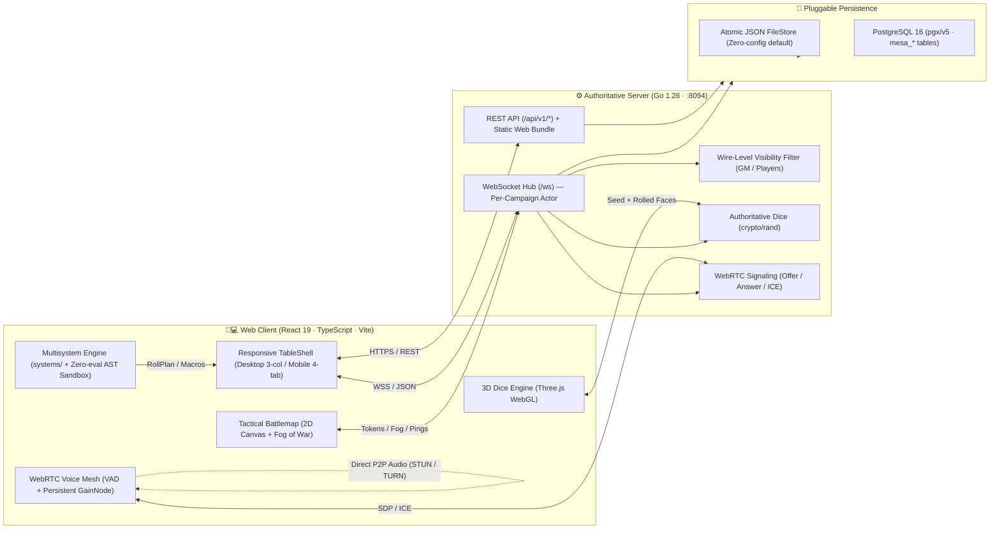

<div align="center">


# 🎲 Mesa VTT

**A free, open-source, mobile-first multisystem Virtual Tabletop (VTT) for playing tabletop RPGs online.**

[🇧🇷 Ler em Português](README.md) · 🇺🇸 **English**

[](LICENSE)
[](https://go.dev/)
[](https://react.dev/)
[](https://www.typescriptlang.org/)
[](https://threejs.org/)
[](#-key-features)
[](#-why-mesa-vtt)

[Why Mesa VTT?](#-why-mesa-vtt) •
[Features](#-key-features) •
[Mighty Blade 3e](#-mighty-blade-3rd-edition--complete--automated) •
[Art Gallery](#-built-in-art-gallery) •
[Architecture](#-architecture) •
[Quick Start](#-quick-start) •
[Roadmap](#-roadmap) •
[Contributing](#-contributing)

</div>

---

## ✨ Why Mesa VTT?

Playing tabletop RPGs online with friends shouldn't mean wrestling with desktop-only VTTs that break on phones, juggling separate Discord calls, scattering character sheets across PDFs, or locking campaigns behind pricey monthly subscriptions.

**Mesa VTT** brings everything a tabletop group needs into a single fast, free, self-hostable web app built from day one for **both smartphones and desktop browsers**:

- **Inspired by RRPG Firecast:** nested campaign folders and Markdown handouts with true GM/player permissions, rich roleplay chat (In-Character, Out-of-Character, Narration, Whispers), and deep love for Brazilian and indie tabletop RPGs.
- **Tactical power of Foundry VTT:** interactive battlemap canvas with Fog of War, tokens with live HP/MP bars, distance ruler, synchronized pings, real-time 3D dice, and a deeply scriptable multisystem engine.
- **Discord-style built-in voice:** 1-tap WebRTC voice channels that stay mounted at the top of the table — switching between Chat, Map, Sheets, and Library on a phone **never drops your call**.

Everything ships as a **single lightweight Go 1.26 binary / Docker image** that runs out of the box with **zero external database** (atomic JSON file store) or scales effortlessly onto **PostgreSQL**.

---

## 🚀 Key Features

| Pillar | Included Out of the Box |
|---|---|
| 🎙️ **Discord-Style Integrated Voice (WebRTC + VAD)** | Low-latency P2P audio mesh with zero heavy media-server overhead. **1-tap** join, mute, and deafen; Web Audio Voice Activity Detection (**VAD**) with a **glowing emerald ring** around active speakers; per-peer volume sliders; graceful Listen-Only fallback when a mic is unavailable; and **persistent audio** across mobile tabs. |
| 🎲 **Real-Time 3D Dice (Three.js)** | Procedural polyhedra (`d4`, `d6`, `d8`, `d10`, `d12`, `d20`, and `d100`) with crisp Canvas textures and deterministic pre-simulated physics. The Go server rolls faces authoritatively via **`crypto/rand`** so every player sees synchronized 3D dice land strictly on the real values — with a radiant gold glow on **Criticals**, crimson aura on **Fumbles**, and graceful fallback for WebGL or `prefers-reduced-motion`. |
| 🗺️ **Tactical Battlemap + Fog of War** | High-DPI HTML5 Canvas built for both mouse and touch (**pinch-to-zoom**, 1-finger pan/token drag), configurable grid (`1.5m`/square) with snap-to-grid, circular portrait tokens with HP/MP bars & condition badges, **secret GM layer** (`layer: "gm"`), **Fog of War** reveal/hide brush, distance ruler, synchronized pings, **4 built-in SVG maps**, plus custom image uploads (PNG/JPEG/WebP). |
| 📚 **Firecast-Style Library with Real Permissions** | Nested folders, lore notes, and Markdown handouts with illustrations. Visibility tiers (**GM Only**, **All Players**, or **Specific Players**) are **enforced on the Go server at the wire level** — hidden GM notes, secret tokens, hidden scenes, and private rolls are stripped before serialization and never reach unauthorized clients. |
| 🧩 **Zero-`eval` Scriptable Multisystem Engine** | Clean modular architecture under [`systems/`](systems/) shipping with **Mighty Blade 3rd Edition** and **Generic RPG**, powered by a pure-TypeScript AST expression & macro sandbox ([`systems/sandbox.ts`](systems/sandbox.ts)) that is 100% strict-CSP compliant (`script-src 'self'`), blocks prototype pollution, and caps execution steps. |
| ⚔️ **Combat Tracker & Interactive Chat** | Round-based initiative tracker with active-turn highlights, rich chat modes (**IC** as character, **OOC**, **Narration**, **Whisper**), and **Interactive Roll Cards** featuring 1-click action buttons (*Apply Damage*, *Heal*, *Spend Mana*, *Apply Condition*) synced directly with character sheets and map tokens. |

---

## ⚔️ Mighty Blade 3rd Edition — Complete & Automated

Mesa VTT launches with a complete, deeply automated flagship implementation of **Mighty Blade 3rd Edition (3.5)** — Brazil's beloved open-distribution medieval fantasy RPG set in the world of **Drakon**:

<table>
  <thead>
    <tr>
      <th align="center">16</th>
      <th align="center">14</th>
      <th align="center">18</th>
      <th align="center">169</th>
      <th align="center">110</th>
      <th align="center">115</th>
      <th align="center">42</th>
    </tr>
  </thead>
  <tbody>
    <tr>
      <td align="center">Races</td>
      <td align="center">Classes</td>
      <td align="center">Conditions</td>
      <td align="center">Abilities</td>
      <td align="center">Spells<br/><sub>(11 Paths)</sub></td>
      <td align="center">Equipment<br/><sub>(40 weapons · 20 armor/shields · 55 gear)</sub></td>
      <td align="center">Bestiary<br/><sub>Creatures</sub></td>
    </tr>
  </tbody>
</table>

- **5-Step Hero Creation Wizard:** Race → Class → Attribute Point Distribution (with live derived-stat preview) → Starting Abilities & Spells → Identity & Portrait.
- **Full Rules Automation:** automatic computation of `PV` (HP), `PM` (Mana), `Bloqueio` (Block), `Esquiva` (Dodge), Effective Defense, `Determinação` (Resolve), Movement (`1.5m` grid squares), Encumbrance tiers, and **FN (Required Strength)** checks on weapons, armor, and shields.
- **1-Click Combat & Spellcasting:** `2d6 + Attribute` rolls with automatic **Critical (`6+6`)** and **Critical Fumble (`1+1`)** detection, target defense comparison, automatic **PM** tracking across all 11 Paths of Magic, and drag-ready bestiary creatures.
- **Playing another RPG?** The built-in **Generic RPG (`generic-rpg`)** engine supports custom attributes, arbitrary resource bars, freeform dice expressions (`1d20`, `3d6`, `2d10`, `1d100`, `kh`/`kl`), and full sandboxed macros.

> **Attribution & Respect:** **Mighty Blade 3rd Edition** was created by **Tiago Junges** (with co-authors Domênico Gay and Luciano Abel) and published by **Coisinha Verde** as an official free-distribution Brazilian tabletop RPG. Mesa VTT is an independent community open-source project providing structured compendium support and VTT automation in celebration of this landmark game.

---

## 🖼️ Built-in Art Gallery

Mesa VTT bundles **17 bespoke, resolution-independent SVG assets** (hero banner, **4 tactical battlemaps** at `1920×1440` on a `24×18` grid, **8 hero/GM portraits**, and **4 monster tokens**) with zero external CDN dependencies — plus built-in upload support for your own maps and portraits.

| The Golden Boar Inn (`tavern.svg`) | Crypt of the Ancients (`dungeon-crypt.svg`) |
| :---: | :---: |
|  |  |
| *Cozy medieval tavern with an L-shaped bar, roaring hearth, bard stage, barrel cellar, and mezzanine stairs (`24×18`).* | *Weathered stone crypt with a central arcane ritual altar, glowing braziers, sarcophagus alcoves, and gated reliquary — built for Fog of War (`24×18`).* |

| Dark Forest Road (`forest-road.svg`) | Drakon Castle Courtyard (`castle-courtyard.svg`) |
| :---: | :---: |
|  |  |
| *Winding dirt road, stone bridge over a clear creek, moss-covered ruins, and a roadside camp ripe for ambushes (`24×18`).* | *Walled medieval citadel courtyard with cobblestone paving, octagonal fountain, market stalls, watchtowers, and drawbridge (`24×18`).* |

---

## 🏗️ Architecture



See [`docs/ARCHITECTURE.md`](docs/ARCHITECTURE.md) for the complete WebSocket envelope reference, domain models, and security invariants.

---

## ⚡ Quick Start

### 1. Docker / Docker Compose (Recommended — One-Liner on `:8094`)

```bash
git clone https://github.com/chadvictor/mesa-vtt.git
cd mesa-vtt

# Launch with zero-config persistent JSON storage
docker compose up -d
```

Open **`http://localhost:8094`** in your browser!

Want **PostgreSQL** instead of the JSON file store (great for larger self-hosted communities)?

```bash
docker compose --profile postgres up -d
```

Or build and run the standalone multi-stage `distroless` image directly:

```bash
docker build -t mesa-vtt .
docker run --rm -p 8094:8094 mesa-vtt
```

### 2. Local Development (Go 1.26 + Node 22 / Vite)

**Terminal 1 — Authoritative Go Server (`:8094`):**

```bash
# Local auth enabled by default + auto-seeds the DRAKON demo campaign
LISTEN_ADDRESS=:8094 go run ./server/cmd/server
```

**Terminal 2 — React + Vite Client (`:3104`, proxies `/api` & `/ws` → `:8094`):**

```bash
cd client
npm install
npm run dev
```

Visit **`http://localhost:3104`** on desktop or via your LAN IP on a phone.

### 3. Seeded Demo Campaign Walkthrough (`DRAKON`)

On first startup with an empty store, Mesa VTT automatically seeds **"Crônicas de Drakon — A Estalagem do Javali Dourado"** (invite code **`DRAKON`**):

1. **Enter the Lobby:** pick a display name in local quick login and open the featured campaign (or click **Join by Code** and enter `DRAKON`). Join as **GM** or **Player**.
2. **Verify Wire-Level Visibility:** open a second private/incognito window as a **Player** alongside your **GM** window:
   - Under **Library → Folders**, `Segredos do Mestre` (*GM Secrets*) is visible only to the GM and never transmitted over the network to players.
   - On **Estalagem do Javali Dourado**, notice the translucent GM-layer spy token (`Goblin Espião`); switch to **Cripta dos Antigos** to paint and reveal **Fog of War** cells in real time.
3. **Roll 3D Dice & Automated Actions:** open any of the 4 pre-built heroes (*Aldric de Valmont*, *Lyra Estrela-da-Alva*, *Borin Martelo-de-Ouro*, *Pip Folha-Ligeira*), trigger an attack or spell, or tap the quick `2d6` bar & macros to watch synchronized **Three.js 3D dice** and 1-click combat buttons in chat.
4. **Test Built-in Voice:** click **"Entrar na Voz"** in the persistent voice bar to join **Mesa Principal** or hop into **Sussurro do Mestre** — then switch freely between Map, Chat, Sheets, and Library with uninterrupted audio.

### 4. Mobile Voice Notes (HTTPS & TURN)

- **HTTPS required on phones:** mobile browsers (iOS Safari and Android Chrome) require a secure context (**HTTPS**) for `getUserMedia` microphone access outside `localhost`. When hosting for remote or LAN mobile players, put Mesa VTT behind an HTTPS reverse proxy (**Caddy**, **Nginx**, **Traefik**, or **Cloudflare Tunnel**) and set `APP_ORIGIN=https://your-domain.com`.
- **Default STUN + Optional TURN:** out of the box, Mesa VTT uses public Google STUN servers (`stun.l.google.com:19302`). For players behind strict carrier-grade NAT (4G/5G/corporate firewalls), add a **TURN** server (e.g., `coturn`) via `MESA_ICE_SERVERS`:

```bash
MESA_ICE_SERVERS='[{"urls":"stun:stun.l.google.com:19302"},{"urls":"turn:turn.yourdomain.com:3478","username":"mesa","credential":"strong-secret"}]'
```

<details>
<summary>📋 Key environment variables (see <code>.env.example</code>)</summary>

| Variable | Default | Description |
|---|---|---|
| `LISTEN_ADDRESS` | `:8094` | HTTP/WebSocket bind address. |
| `AUTH_MODE` | `local` | `local` (built-in quick login) or `sso` (external ticket authentication). |
| `DATABASE_URL` | *(empty)* | Optional PostgreSQL DSN. Falls back to atomic JSON FileStore when unset. |
| `MESA_DATA_FILE` | `.mesa-vtt-data.json` | JSON file path when running without PostgreSQL. |
| `SESSION_SECRET` | *(ephemeral random)* | HMAC-SHA256 signing key for session tokens (set a persistent value in production). |
| `APP_ORIGIN` | `http://localhost:8094` | Allowed origin for CORS and WebSocket origin checks in production. |
| `MESA_ICE_SERVERS` | Google STUN | JSON array of WebRTC STUN/TURN servers served to clients. |
| `STATIC_DIR` | *(empty / `/app/web` in Docker)* | Directory holding the compiled frontend (`client/dist`) served by the Go binary. |
| `GEMINI_API_KEY` | *(optional)* | Optional API key for AI-assisted map/portrait generation when enabled. |

</details>

---

## 🗺️ Roadmap

- [ ] 🇧🇷 **Tagmar — Next Official Open-Source Brazilian RPG System!** Full native support for Brazil's pioneering 1991 open-source fantasy RPG (*Projeto Tagmar*), bringing its iconic `1d20` column-based Resolution Table, EF/EH health pools, Karma, professions, spells, and bestiary into `systems/tagmar/`. *(Want to help build it? Check out the starter blueprint in [`docs/CREATING_SYSTEMS.md`](docs/CREATING_SYSTEMS.md)!)*
- [ ] 📦 **Community System Packs** — Turnkey modules for Old Dragon, 3D&T, D20/SRD systems, `d100` investigative games, and narrative RPGs.
- [ ] 🕯️ **Dynamic Lighting & Line of Sight (LoS)** — Light-blocking walls, token light sources, and automatic racial darkvision.
- [ ] 🎵 **Synchronized Audio Ambience & Soundboard** — Tavern loops, dungeon ambience, weather, and GM-triggered SFX.
- [ ] 📱 **Installable Mobile PWA** — Home-screen app experience on Android/iOS, turn notifications, and offline sheet/compendium browsing.
- [ ] 🔌 **Community Plugin & Asset Registry** — Shareable packs for RPG systems, SVG battlemaps, token art, and macro libraries.

---

## 🤝 Contributing

Contributions of all kinds are welcome — Go backend, React/Three.js frontend, new RPG system modules, SVG battlemaps, translations, and bug reports!

- Read **[`CONTRIBUTING.md`](CONTRIBUTING.md)** for local dev setup, test commands, security invariants, and PR standards.
- Building a new RPG system (like **Tagmar**)? Follow **[`docs/CREATING_SYSTEMS.md`](docs/CREATING_SYSTEMS.md)**.
- Deep-dive into the architecture in **[`docs/ARCHITECTURE.md`](docs/ARCHITECTURE.md)**.

---

## 📄 License

Released under the **MIT License**. See [`LICENSE`](LICENSE) for details.

<div align="center">
  <sub>Built with ❤️ for tabletop RPG players and Game Masters — on phones and desktops alike.</sub>
</div>
