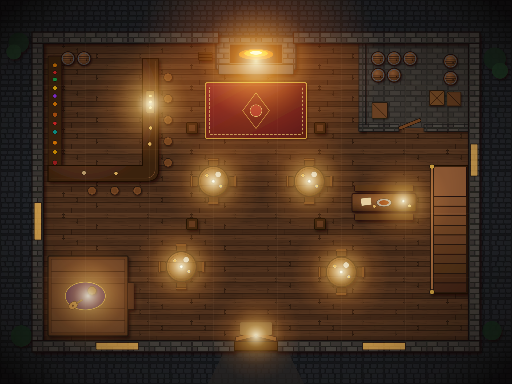
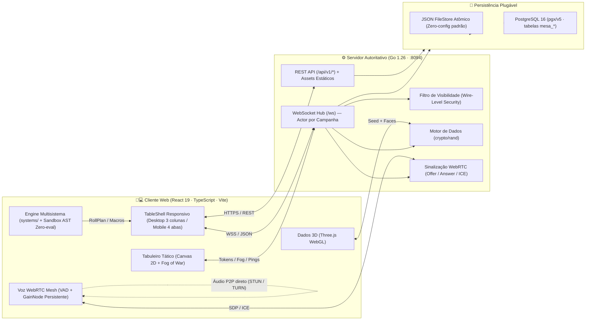

<div align="center">


# 🎲 Mesa VTT

**Mesa Virtual (VTT) multisistema, gratuita, open source e mobile-first para jogar RPG de mesa online.**

🇧🇷 **Português (Brasil)** · [🇺🇸 Read in English](README.en.md)

[](LICENSE)
[](https://go.dev/)
[](https://react.dev/)
[](https://www.typescriptlang.org/)
[](https://threejs.org/)
[](#-funcionalidades-principais)
[](#-por-que-o-mesa-vtt)

[Por que o Mesa VTT?](#-por-que-o-mesa-vtt) •
[Funcionalidades](#-funcionalidades-principais) •
[Mighty Blade 3ª Ed.](#-mighty-blade-3ª-edição--completo--automatizado) •
[Galeria](#-galeria-de-mapas-embutidos) •
[Arquitetura](#-arquitetura) •
[Início Rápido](#-início-rápido) •
[Roadmap](#-roadmap) •
[Contribuir](#-contribuindo)

</div>

---

## ✨ Por que o Mesa VTT?

Jogar RPG de mesa online com amigos não deveria exigir abrir um VTT pesado que só funciona em monitor grande, conciliar chamadas separadas no Discord, espalhar fichas em PDFs e pagar assinaturas caras em dólar.

O **Mesa VTT** nasceu para reunir em um único aplicativo web leve, gratuito e auto-hospedável tudo o que um grupo precisa — **tanto no celular quanto no computador**:

- **A alma do RRPG Firecast:** biblioteca hierárquica de pastas e handouts com permissões reais de Mestre/Jogador, chat imersivo (Em Personagem, Fora do Personagem, Narração e Sussurros) e carinho genuíno pela cena brasileira de RPG.
- **O poder tático do Foundry VTT:** tabuleiro interativo com grade e Névoa de Guerra (*Fog of War*), tokens com barras de PV/PM, régua, pings sincronizados, dados 3D em tempo real e engine multisistema scriptável.
- **A praticidade de voz do Discord:** canais de voz WebRTC embutidos com 1 toque para entrar, mutar ou ensurdecer — sempre ativos no topo da tela, sem cair quando você troca entre Chat, Mapa, Fichas e Biblioteca no celular.

Tudo isso empacotado em um **único servidor Go 1.26**, que roda localmente **sem banco de dados externo** (usando armazenamento JSON atômico) ou escala facilmente com **PostgreSQL**.

---

## 🚀 Funcionalidades Principais

| Pilar | O que já vem pronto no Mesa VTT |
|---|---|
| 🎙️ **Voz Integrada estilo Discord (WebRTC + VAD)** | Malha P2P de baixa latência sem media server pesado. **1 toque** para entrar, mutar ou ensurdecer; detecção de atividade vocal (**VAD**) com **anel esmeralda luminoso** em quem está falando; volume individual por jogador; modo ouvinte (*Listen-Only*) caso o microfone esteja indisponível; e **áudio persistente** ao alternar de aba no celular. |
| 🎲 **Dados 3D em Tempo Real (Three.js)** | Poliedros procedurais (`d4`, `d6`, `d8`, `d10`, `d12`, `d20` e `d100`) com texturas de alta definição e física determinística pré-simulada. O servidor sorteia os resultados com **`crypto/rand`** e todos os navegadores animam os dados caindo exatamente nas faces reais — com brilho dourado em **Crítico** e aura carmesim em **Falha Crítica** (além de fallback suave e respeito a `prefers-reduced-motion`). |
| 🗺️ **Tabuleiro Tático + Fog of War** | Canvas HTML5 de alta densidade com **pinch-to-zoom** e arraste por 1 dedo no celular, grade configurável (`1,5m`/quadrado) com *snap-to-grid*, tokens com retratos circulares e barras de PV/PM, **camada secreta do Mestre** (`layer: "gm"`), pincel de **Névoa de Guerra** (revelar/ocultar células), régua de distância, pings animados sincronizados, **4 mapas SVG embutidos** e upload de mapas próprios (PNG/JPEG/WebP). |
| 📚 **Biblioteca estilo Firecast com Permissões Reais** | Pastas aninhadas, notas, lore e handouts em Markdown com suporte a ilustrações. As permissões (**Só Mestre**, **Todos os Jogadores** ou **Jogadores Específicos**) são **filtradas no servidor Go antes de enviar pela rede** — segredos do Mestre, tokens ocultos e rolagens secretas jamais vazam no tráfego dos jogadores. |
| 🧩 **Engine Multisistema Scriptável (Zero-`eval`)** | Arquitetura modular em [`systems/`](systems/) com dois sistemas embutidos (**Mighty Blade 3ª Edição** e **RPG Genérico**) e interpretador AST próprio em TypeScript ([`systems/sandbox.ts`](systems/sandbox.ts)) 100% compatível com CSP restrito (`script-src 'self'`), sem `eval`/`new Function` e protegido contra *prototype pollution* e loops infinitos. |
| ⚔️ **Combate & Chat Interativo** | Rastreador de iniciativa por rodadas com destaque do turno ativo, chat com modos **IC** (falando como personagem), **OOC**, **Narração**, **Sussurro** e **Cartões de Rolagem Interativos** com botões de 1 clique (*Aplicar Dano*, *Curar*, *Gastar PM*, *Aplicar Condição*) sincronizados direto com as fichas e os tokens no mapa. |

---

## ⚔️ Mighty Blade 3ª Edição — Completo & Automatizado

O sistema carro-chefe do Mesa VTT traz suporte completo e automatizado ao clássico RPG brasileiro de fantasia medieval **Mighty Blade 3ª Edição (3.5)**, ambientado em **Drakon**:

<table>
  <thead>
    <tr>
      <th align="center">16</th>
      <th align="center">14</th>
      <th align="center">18</th>
      <th align="center">169</th>
      <th align="center">110</th>
      <th align="center">115</th>
      <th align="center">42</th>
    </tr>
  </thead>
  <tbody>
    <tr>
      <td align="center">Raças</td>
      <td align="center">Classes</td>
      <td align="center">Condições</td>
      <td align="center">Habilidades</td>
      <td align="center">Magias<br/><sub>(11 Caminhos)</sub></td>
      <td align="center">Equipamentos<br/><sub>(40 armas · 20 defesas · 55 itens)</sub></td>
      <td align="center">Criaturas<br/><sub>no Bestiário</sub></td>
    </tr>
  </tbody>
</table>

- **Assistente de Criação de Herói em 5 passos:** escolha Raça → Classe → Distribuição de Atributos (com prévia em tempo real de atributos derivados) → Habilidades e Magias iniciais → Nome, Retrato e História.
- **Automação real de regras:** cálculo automático de `PV`, `PM`, `Bloqueio`, `Esquiva`, `Defesa Efetiva`, `Determinação`, `Deslocamento` (em metros e quadrados de `1,5m`), `Carga` (`Básica`, `Pesada` e `Máxima`) e verificação automática de **FN (Força Necessária)** em armas, armaduras e escudos.
- **Combate & Conjuração em 1 clique:** testes `2d6 + Atributo`, detecção automática de **Crítico (`6+6`)** e **Falha Crítica (`1+1`)**, comparação contra a Defesa do alvo, gasto de **PM** em magias dos 11 caminhos (*Água e Gelo, Ar e Relâmpago, Arcano, Encantamento, Fogo, Ilusão, Luz, Natureza, Necromancia, Terra e Trevas*) e bestiário pronto para arrastar diretamente no tabuleiro.
- **Joga outro sistema?** O módulo **RPG Genérico (`generic-rpg`)** já vem incluso com atributos editáveis, barras de recursos personalizadas, fórmulas livres (`1d20`, `3d6`, `2d10`, `1d100`, `kh`/`kl`) e suporte completo a macros.

> **Créditos e Reconhecimento:** **Mighty Blade 3ª Edição** é uma criação de **Tiago Junges** (com coautoria de Domênico Gay e Luciano Abel) publicada pela **Coisinha Verde** sob distribuição gratuita oficial para a comunidade. O Mesa VTT é um projeto independente da comunidade que oferece suporte estruturado e automação de mesa em homenagem a esse marco do RPG nacional.

---

## 🖼️ Galeria de Mapas Embutidos

O Mesa VTT já acompanha **17 artes vetoriais em SVG** leves e nítidas em qualquer zoom (banner, **4 mapas táticos** `1920×1440` em grade `24×18`, **8 retratos de heróis/Mestre** e **4 tokens de monstros**), prontas para jogar offline ou na primeira execução — além de permitir upload de mapas e retratos próprios.

| Estalagem do Javali Dourado (`tavern.svg`) | Cripta dos Antigos (`dungeon-crypt.svg`) |
| :---: | :---: |
|  |  |
| *Taverna medieval com balcão em L, lareira acesa, palco de bardo, adega e escadaria para o mezanino (`24×18`).* | *Cripta subterrânea de pedra com altar arcano central, braseiros, sarcófagos e relicário gradeado — ideal para Fog of War (`24×18`).* |

| Estrada da Floresta Sombria (`forest-road.svg`) | Pátio do Castelo de Drakon (`castle-courtyard.svg`) |
| :---: | :---: |
|  |  |
| *Estrada sinuosa com ponte de pedra sobre riacho, ruínas cobertas de musgo e acampamento pronto para emboscadas (`24×18`).* | *Cidadela murada com fonte octogonal, tendas de mercado, torres de vigia e portão levadiço (`24×18`).* |

---

## 🏗️ Arquitetura



Para aprofundar no protocolo WebSocket, modelos de dados e garantias de segurança, consulte [`docs/ARCHITECTURE.md`](docs/ARCHITECTURE.md).

---

## ⚡ Início Rápido

### 1. Docker / Docker Compose (Recomendado — 1 comando na porta `:8094`)

```bash
git clone https://github.com/chadvictor/mesa-vtt.git
cd mesa-vtt

# Subir com armazenamento JSON persistente (zero-config)
docker compose up -d
```

Abra **`http://localhost:8094`** no navegador!

Quer usar **PostgreSQL** em vez do arquivo JSON (ideal para servidores comunitários)?

```bash
docker compose --profile postgres up -d
```

Ou rode diretamente com Docker sem Compose (imagem *all-in-one* multi-stage baseada em `distroless`):

```bash
docker build -t mesa-vtt .
docker run --rm -p 8094:8094 mesa-vtt
```

### 2. Desenvolvimento Local (Go 1.26 + Node 22 / Vite)

**Terminal 1 — Servidor Go autoritativo (`:8094`):**

```bash
# Modo local habilitado por padrão + cria automaticamente a campanha demo DRAKON
LISTEN_ADDRESS=:8094 go run ./server/cmd/server
```

**Terminal 2 — Cliente React + Vite (`:3104` com proxy `/api` e `/ws` → `:8094`):**

```bash
cd client
npm install
npm run dev
```

Acesse **`http://localhost:3104`** no desktop ou pelo IP da rede local no celular.

### 3. Tour pela Campanha Demo (`DRAKON`)

Na primeira inicialização com armazenamento vazio, o Mesa VTT semeia automaticamente a aventura introdutória **"Crônicas de Drakon — A Estalagem do Javali Dourado"** (código de convite **`DRAKON`**):

1. **Entre no Lobby:** informe seu nome de exibição no login rápido local e clique na campanha destacada (ou clique em **Entrar por Código** e digite `DRAKON`). Você pode entrar como **Mestre** ou **Jogador**.
2. **Teste a segurança real de visibilidade:** abra uma segunda aba/janela anônima entrando como **Jogador** enquanto a primeira está como **Mestre**:
   - Na aba **Biblioteca → Pastas**, a pasta `Segredos do Mestre` (*A Conspiração do Culto Carmesim*, *Armadilhas da Cripta*) aparece só para o Mestre e nem sequer é enviada na rede para o Jogador.
   - Na cena **Estalagem do Javali Dourado**, o token `Goblin Espião (Oculto)` fica semitransparente na camada do Mestre; alterne para **Cripta dos Antigos** para testar o pincel de **Névoa de Guerra** em tempo real.
3. **Explore as fichas e role os Dados 3D:** abra qualquer um dos 4 heróis prontos (*Aldric de Valmont*, *Lyra Estrela-da-Alva*, *Borin Martelo-de-Ouro* e *Pip Folha-Ligeira*), dispare um ataque ou magia, ou use a barra rápida `2d6` / macros para ver os **Dados 3D em Three.js** e os botões interativos no chat.
4. **Experimente a Voz Integrada:** toque em **"Entrar na Voz"** na barra persistente para entrar no canal **Mesa Principal** ou mudar para o **Sussurro do Mestre** — depois navegue livremente entre Mapa, Chat, Fichas e Biblioteca sem perder o áudio.

### 4. Voz no Celular, HTTPS e TURN (Auto-Hospedagem)

- **HTTPS obrigatório no celular:** navegadores móveis (Safari no iOS e Chrome no Android) bloqueiam `navigator.mediaDevices.getUserMedia` em páginas HTTP que não sejam `localhost`. Para jogar com amigos via celular pela internet ou rede local, exponha o Mesa VTT atrás de um proxy HTTPS (como **Caddy**, **Nginx**, **Traefik** ou **Cloudflare Tunnel**) e ajuste `APP_ORIGIN=https://seu-dominio.com`.
- **STUN padrão + TURN para redes móveis restritivas (CGNAT):** por padrão, o servidor envia servidores STUN públicos do Google (`stun.l.google.com:19302`). Se jogadores em redes 4G/5G corporativas ou simétricas tiverem dificuldade para fechar conexão P2P, configure um servidor **TURN** (por exemplo, `coturn`) na variável `MESA_ICE_SERVERS`:

```bash
MESA_ICE_SERVERS='[{"urls":"stun:stun.l.google.com:19302"},{"urls":"turn:turn.seudominio.com:3478","username":"mesa","credential":"sua-senha-forte"}]'
```

<details>
<summary>📋 Principais variáveis de ambiente (consulte <code>.env.example</code>)</summary>

| Variável | Padrão | Descrição |
|---|---|---|
| `LISTEN_ADDRESS` | `:8094` | Endereço e porta do servidor HTTP/WebSocket. |
| `AUTH_MODE` | `local` | `local` (login rápido embutido) ou `sso` (integração externa via ticket). |
| `DATABASE_URL` | *(vazio)* | URL PostgreSQL opcional. Se vazia, usa armazenamento JSON atômico. |
| `MESA_DATA_FILE` | `.mesa-vtt-data.json` | Caminho do arquivo de dados quando `DATABASE_URL` não está definida. |
| `SESSION_SECRET` | *(gerado em runtime)* | Segredo HMAC-SHA256 para assinar tokens de sessão (defina um valor fixo em produção). |
| `APP_ORIGIN` | `http://localhost:8094` | Origem permitida para CORS e validação de WebSocket em produção. |
| `MESA_ICE_SERVERS` | Google STUN | Array JSON de servidores STUN/TURN entregues aos clientes WebRTC. |
| `STATIC_DIR` | *(vazio / `/app/web` no Docker)* | Diretório com o build do frontend (`client/dist`) servido diretamente pelo Go. |
| `GEMINI_API_KEY` | *(opcional)* | Chave opcional para geração assistida de mapas/retratos por IA, quando habilitada. |

</details>

---

## 🗺️ Roadmap

O Mesa VTT está só começando! Estas são as próximas grandes entregas planejadas junto à comunidade:

- [ ] 🇧🇷 **Tagmar — Próximo Sistema Brasileiro Open Source Oficial!** Integração completa do pioneiro RPG de fantasia medieval brasileiro (*Projeto Tagmar*), incluindo a icônica **Tabela de Resolução `1d20` por colunas**, `EF`/`EH`, Karma, profissões, raças, magias e bestiário nativos em `systems/tagmar/`. *(Quer liderar ou ajudar nesse módulo? Já deixamos um blueprint pronto em [`docs/CREATING_SYSTEMS.md`](docs/CREATING_SYSTEMS.md)!)*
- [ ] 📦 **Mais Pacotes de Sistemas da Comunidade** — Templates prontos para Old Dragon, 3D&T, sistemas `d20`/SRD, sistemas `d100` e RPGs narrativos.
- [ ] 🕯️ **Iluminação Dinâmica & Linha de Visão (LoS)** — Paredes bloqueadoras de luz, tochas acopladas a tokens e visão noturna automática por raça.
- [ ] 🎵 **Mesa Sonora & Ambiência Sincronizada** — Playlists de taverna, masmorra, chuva e efeitos sonoros controlados pelo Mestre para todo o grupo.
- [ ] 📱 **PWA Instalável** — Instalação na tela inicial do Android e iOS, notificações de turno e consulta offline de fichas e compêndio.
- [ ] 🔌 **Registro de Plugins, Mapas e Macros da Comunidade** — Pacotes instaláveis de sistemas, mapas táticos SVG, coleções de tokens e bibliotecas de macros.

---

## 🤝 Contribuindo

Contribuições são muito bem-vindas — seja código (Go, TypeScript, React, Three.js), novos sistemas de RPG, mapas táticos em SVG, traduções ou relatos de bugs!

- Leia o guia de contribuição em **[`CONTRIBUTING.md`](CONTRIBUTING.md)** para setup local, testes e regras de segurança.
- Quer adicionar o seu RPG favorito (como **Tagmar**)? Siga o passo a passo prático em **[`docs/CREATING_SYSTEMS.md`](docs/CREATING_SYSTEMS.md)**.
- Consulte a visão técnica completa em **[`docs/ARCHITECTURE.md`](docs/ARCHITECTURE.md)**.

---

## 📄 Licença

Distribuído sob a licença **MIT**. Veja [`LICENSE`](LICENSE) para mais detalhes.

<div align="center">
  <sub>Feito com ❤️ para mestres e jogadores de RPG de mesa — no celular ou no computador.</sub>
</div>
