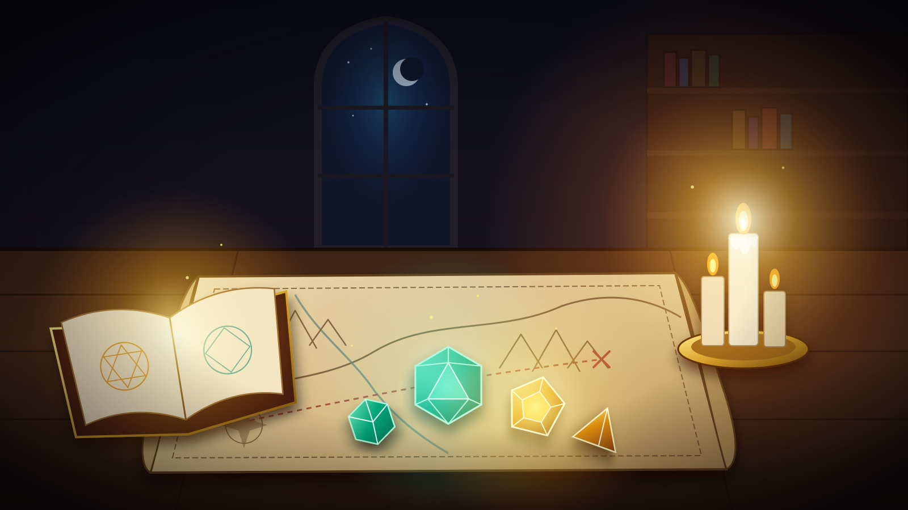
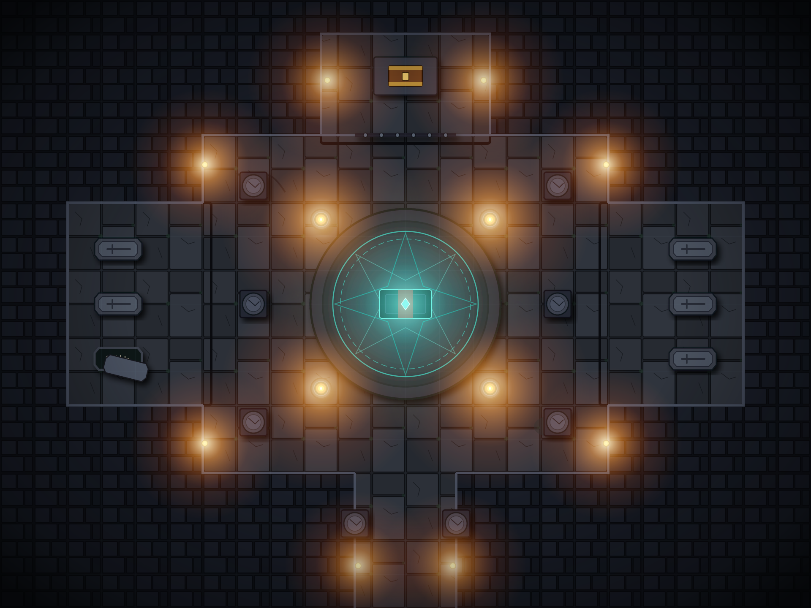
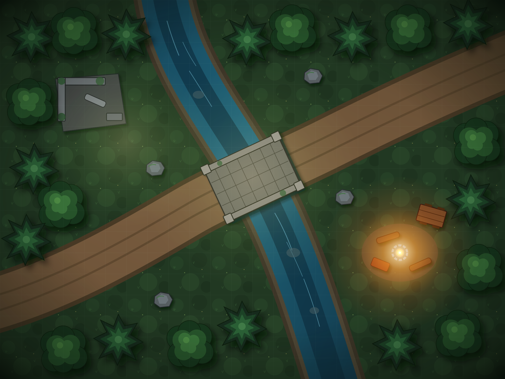
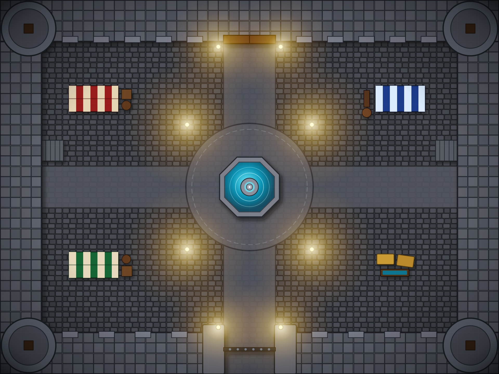
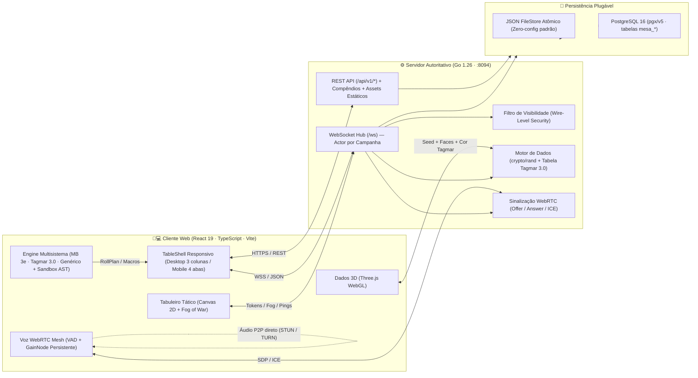

<div align="center">



# 🎲 Mesa VTT

**Mesa Virtual (VTT) multisistema, gratuita, open source e mobile-first para jogar RPG de mesa online — com Mighty Blade 3ª Edição e Tagmar 3.0 + Expansões integrados.**

🇧🇷 **Português (Brasil)** · [🇺🇸 Read in English](README.en.md)

[](LICENSE)
[](data/tagmar/LICENSE.md)
[](https://go.dev/)
[](https://react.dev/)
[](https://www.typescriptlang.org/)
[](https://threejs.org/)
[](#-funcionalidades-principais)
[](#-por-que-o-mesa-vtt)

[Por que o Mesa VTT?](#-por-que-o-mesa-vtt) •
[Funcionalidades](#-funcionalidades-principais) •
[Sistemas Incluídos](#-sistemas-incluídos) •
[Galeria](#-galeria-de-mapas-embutidos) •
[Arquitetura](#-arquitetura) •
[Início Rápido](#-início-rápido) •
[Roadmap](#-roadmap) •
[Licenças](#-licenças)

</div>

---

## ✨ Por que o Mesa VTT?

Jogar RPG de mesa online com amigos não deveria exigir abrir um VTT pesado que só funciona em monitor grande, conciliar chamadas separadas no Discord, espalhar fichas em PDFs e pagar assinaturas caras em dólar.

O **Mesa VTT** nasceu para reunir em um único aplicativo web leve, gratuito e auto-hospedável tudo o que um grupo precisa — **tanto no celular quanto no computador**:

- **A alma do RRPG Firecast:** biblioteca hierárquica de pastas e handouts com permissões reais de Mestre/Jogador, chat imersivo (Em Personagem, Fora do Personagem, Narração e Sussurros) e carinho genuíno pelos grandes sistemas brasileiros de RPG (**Mighty Blade 3ª Edição** e **Tagmar 3.0**).
- **O poder tático do Foundry VTT:** tabuleiro interativo com grade e Névoa de Guerra (*Fog of War*), tokens com barras de PV/PM ou EH/EF, régua, pings sincronizados, dados 3D em tempo real e engine multisistema scriptável.
- **A praticidade de voz do Discord:** canais de voz WebRTC embutidos com 1 toque para entrar, mutar ou ensurdecer — sempre ativos no topo da tela, sem cair quando você troca entre Chat, Mapa, Fichas e Biblioteca no celular.

Tudo isso empacotado em um **único servidor Go 1.26**, que roda localmente **sem banco de dados externo** (usando armazenamento JSON atômico) ou escala facilmente com **PostgreSQL**.

---

## 🚀 Funcionalidades Principais

| Pilar | O que já vem pronto no Mesa VTT |
|---|---|
| 🎙️ **Voz Integrada estilo Discord (WebRTC + VAD)** | Malha P2P de baixa latência sem media server pesado. **1 toque** para entrar, mutar ou ensurdecer; detecção de atividade vocal (**VAD**) com **anel esmeralda luminoso** em quem está falando; volume individual por jogador; modo ouvinte (*Listen-Only*) caso o microfone esteja indisponível; e **áudio persistente** ao alternar de aba no celular. |
| 🎲 **Dados 3D em Tempo Real (Three.js)** | Poliedros procedurais (`d4`, `d6`, `d8`, `d10`, `d12`, `d20` e `d100`) com texturas de alta definição e física determinística pré-simulada. O servidor sorteia os resultados com **`crypto/rand`** e todos os navegadores animam os dados caindo exatamente nas faces reais — com destaque especial para **Crítico**, **Falha Crítica** e as faixas coloridas da **Tabela de Resolução de Tagmar 3.0** (além de fallback suave e respeito a `prefers-reduced-motion`). |
| 🗺️ **Tabuleiro Tático + Fog of War** | Canvas HTML5 de alta densidade com **pinch-to-zoom** e arraste por 1 dedo no celular, grade configurável (`1,5m`/quadrado) com *snap-to-grid*, tokens com retratos circulares e barras sincronizadas (`PV`/`PM` ou `EH`/`EF`), **camada secreta do Mestre** (`layer: "gm"`), pincel de **Névoa de Guerra** (revelar/ocultar células), régua de distância, pings animados sincronizados, **4 mapas SVG embutidos** e upload de mapas próprios (PNG/JPEG/WebP). |
| 📚 **Biblioteca estilo Firecast com Permissões Reais** | Pastas aninhadas, notas, lore e handouts em Markdown com suporte a ilustrações. As permissões (**Só Mestre**, **Todos os Jogadores** ou **Jogadores Específicos**) são **filtradas no servidor Go antes de enviar pela rede** — segredos do Mestre, tokens ocultos e rolagens secretas jamais vazam no tráfego dos jogadores. |
| 🧩 **Engine Multisistema Scriptável (Zero-`eval`)** | Arquitetura modular em [`systems/`](systems/) com **3 sistemas embutidos** (**Mighty Blade 3ª Edição**, **Tagmar 3.0 + Expansões** e **RPG Genérico**) e interpretador AST próprio em TypeScript ([`systems/sandbox.ts`](systems/sandbox.ts)) 100% compatível com CSP restrito (`script-src 'self'`), sem `eval`/`new Function` e protegido contra *prototype pollution* e loops infinitos. |
| ⚔️ **Combate & Chat Interativo** | Rastreador de iniciativa por rodadas (`2d6` no Mighty Blade, `1d10 + AGI` no Tagmar 3.0, livre no Genérico), chat com modos **IC**, **OOC**, **Narração**, **Sussurro**, comandos `/r 1d20 col N` e **Cartões de Rolagem Interativos** com botões de 1 clique (*Aplicar Dano EH→EF ou Direto na EF*, *Curar*, *Gastar PM/Karma*, *Rolar RF/RM*, *Aplicar Condição*). |

---

## 🎮 Sistemas Incluídos

### ⚔️ Mighty Blade 3ª Edição (`mighty-blade-3e`) — Completo & Automatizado

Suporte completo e automatizado ao clássico RPG brasileiro de fantasia medieval **Mighty Blade 3ª Edição (3.5)**, ambientado em **Drakon**:

<table>
  <thead>
    <tr>
      <th align="center">16</th>
      <th align="center">14</th>
      <th align="center">18</th>
      <th align="center">169</th>
      <th align="center">110</th>
      <th align="center">115</th>
      <th align="center">42</th>
    </tr>
  </thead>
  <tbody>
    <tr>
      <td align="center">Raças</td>
      <td align="center">Classes</td>
      <td align="center">Condições</td>
      <td align="center">Habilidades</td>
      <td align="center">Magias<br/><sub>(11 Caminhos)</sub></td>
      <td align="center">Equipamentos<br/><sub>(40 armas · 20 defesas · 55 itens)</sub></td>
      <td align="center">Criaturas<br/><sub>no Bestiário</sub></td>
    </tr>
  </tbody>
</table>

- **Assistente de Criação de Herói em 5 passos:** Raça → Classe → Distribuição de Atributos (prévia em tempo real) → Habilidades e Magias iniciais → Nome, Retrato e História.
- **Automação real de regras:** `PV`, `PM`, `Bloqueio`, `Esquiva`, `Defesa Efetiva`, `Determinação`, `Deslocamento` (`1,5m`/quadrado), `Carga` (`Básica`, `Pesada`, `Máxima`) e verificação automática de **FN (Força Necessária)** em armas, armaduras e escudos.
- **Combate & Conjuração em 1 clique:** testes `2d6 + Atributo`, detecção automática de **Crítico (`6+6`)** e **Falha Crítica (`1+1`)**, gasto de **PM** em magias dos 11 caminhos e bestiário pronto para invocar no mapa.
- **Campanha pronta incluída:** **`DRAKON`** (*"Crônicas de Drakon — A Estalagem do Javali Dourado"*).

> **Créditos:** **Mighty Blade 3ª Edição** é uma criação de **Tiago Junges** (com coautoria de Domênico Gay e Luciano Abel) publicada pela **Coisinha Verde** sob distribuição gratuita oficial para a comunidade.

---

### 🛡️ Tagmar 3.0 + Expansões (`tagmar-3`) — Completo & Automatizado

Suporte nativo e fiel ao primeiro RPG brasileiro de fantasia medieval — **Tagmar 3.0 e expansões oficiais do Projeto Tagmar** (*Livro de Regras*, *Livro de Magias*, *Livro das Ordens Sacerdotais*, *Livro das Criaturas*, *Equipamentos & Objetos Mágicos* e *Aventuras nas Terras Selvagens*):

<table>
  <thead>
    <tr>
      <th align="center">15</th>
      <th align="center">42</th>
      <th align="center">24</th>
      <th align="center">103</th>
      <th align="center">187</th>
      <th align="center">148</th>
      <th align="center">48</th>
    </tr>
  </thead>
  <tbody>
    <tr>
      <td align="center">Raças<br/><sub>(6 Básico · 9 Expansões)</sub></td>
      <td align="center">Profissões & Espec.<br/><sub>(6 Base · 36 incl. 13 Ordens)</sub></td>
      <td align="center">Condições<br/><sub>Automatizadas</sub></td>
      <td align="center">Habilidades & Téc.<br/><sub>(66 Hab. · 37 Combate)</sub></td>
      <td align="center">Magias<br/><sub>(Colégios, Ordens & Trilhas)</sub></td>
      <td align="center">Equip. & Relíquias<br/><sub>(52 armas · 28 defesas · 68 itens)</sub></td>
      <td align="center">Criaturas<br/><sub>(Livro das Criaturas)</sub></td>
    </tr>
  </tbody>
</table>

- **Tabela de Resolução `1d20` Colorida (Colunas `-7` a `20+`):** o servidor Go e o cliente resolvem toda rolagem `1d20` na tabela oficial exata — **Erro Crítico**, **Falha**, **Verde (25%)**, **Amarelo (50%)**, **Laranja (75%)**, **Vermelho (100%)** e **Azul — Crítico (125% · Dano direto na EF!)**, incluindo a regra oficial de *overflow* acima da Coluna 20 e consulta interativa no compêndio.
- **Tabela de Resistências (`RF` & `RM`):** matriz completa de `460` células (`FD -2..20` × `FA 1..20`) com botões de 1 toque na ficha e follow-up automático em cartões de magia.
- **Fluxo Autêntico de Dano & Saúde (`EH → Absorção → EF`):** dano normal é absorvido primeiro pela **Energia Heróica (`EH`)**, depois pela **Absorção** da armadura/escudo/elmo e só então atinge a **Energia Física (`EF`)** — com **Inconsciente** (`EF ≤ 0`), **Agonizando** (`EF < 0`) e **Morto** (`EF ≤ -15`) automáticos; já o **Golpe Crítico (Azul)** ignora `EH` e Absorção comum, atingindo a `EF` diretamente!
- **Assistente de Criação em 5 passos + Ficha Completa:** compra progressiva de atributos (15 pts / 16 pts Humano), 6 atributos (`INT`, `AUR`, `CAR`, `FOR`, `FIS`, `AGI`), `Karma` místico `(AUR + 1) × (Estágio + 1)`, `DA`/`DP`/`Absorção`, `VB`, Iniciativa `1d10 + AGI`, moedas `MO`/`MP`/`MC`, evolução de Estágio (`1–20`) com desbloqueio de Especialização/Ordem/Colégio no Estágio 5 e invocação de criaturas do *Livro das Criaturas* direto no mapa.
- **Campanha pronta incluída:** **`TAGMAR`** (*"Crônicas de Tagmar — Fronteira de Verrogar"*), com 4 heróis prontos (*Kael de Verrogar*, *Aelindra*, *Thorgar*, *Liriel*), 2 cenas táticas, pastas de segredos do Mestre e macros Tagmar prontas.

> **Licença e Créditos do Compêndio Tagmar:** Os dados em [`data/tagmar/`](data/tagmar/) seguem a licença oficial do **Projeto Tagmar** — **Creative Commons Atribuição-NãoComercial-CompartilhaIgual 3.0 Brasil (`CC BY-NC-SA 3.0 BR`)** (<https://www.tagmar.com.br>), creditando Marcelo Rodrigues, Ygor Moraes Esteves da Silva, Julio Augusto Cezar Junior, Leonardo Nahoum Pache de Faria e a comunidade do Projeto Tagmar. Veja [`data/tagmar/LICENSE.md`](data/tagmar/LICENSE.md) e [`NOTICE.md`](NOTICE.md).

---

### 🧩 RPG Genérico (`generic-rpg`) — Livre & Personalizável

Joga outro sistema? O módulo **RPG Genérico** já vem incluso com atributos editáveis, barras de recursos personalizadas, fórmulas livres (`1d20`, `3d6`, `2d10`, `1d100`, `kh`/`kl`) e suporte completo às macros no sandbox zero-`eval`.

---

## 🖼️ Galeria de Mapas Embutidos

O Mesa VTT já acompanha **17 artes vetoriais em SVG** leves e nítidas em qualquer zoom (banner, **4 mapas táticos** `1920×1440` em grade `24×18`, **8 retratos de heróis/Mestre** e **4 tokens de monstros**), prontas para jogar offline ou na primeira execução — além de permitir upload de mapas e retratos próprios.

| Estalagem do Javali Dourado (`tavern.svg`) | Cripta dos Antigos (`dungeon-crypt.svg`) |
| :---: | :---: |
|  |  |
| *Taverna medieval com balcão em L, lareira acesa, palco de bardo, adega e escadaria para o mezanino (`24×18`).* | *Cripta subterrânea de pedra com altar arcano central, braseiros, sarcófagos e relicário gradeado — ideal para Fog of War (`24×18`).* |

| Estrada da Floresta Sombria (`forest-road.svg`) | Pátio do Castelo / Fortaleza (`castle-courtyard.svg`) |
| :---: | :---: |
|  |  |
| *Estrada sinuosa com ponte de pedra sobre riacho, ruínas cobertas de musgo e acampamento pronto para emboscadas (`24×18`).* | *Cidadela murada com fonte octogonal, tendas de mercado, torres de vigia e portão levadiço (`24×18`).* |

---

## 🏗️ Arquitetura



Para aprofundar no protocolo WebSocket, modelos de dados e garantias de segurança, consulte [`docs/ARCHITECTURE.md`](docs/ARCHITECTURE.md).

---

## ⚡ Início Rápido

### 1. Docker / Docker Compose (Recomendado — 1 comando na porta `:8094`)

```bash
git clone https://github.com/chadvictor/mesa-vtt.git
cd mesa-vtt

# Subir com armazenamento JSON persistente (zero-config)
docker compose up -d
```

Abra **`http://localhost:8094`** no navegador!

Quer usar **PostgreSQL** em vez do arquivo JSON (ideal para servidores comunitários)?

```bash
docker compose --profile postgres up -d
```

Ou rode diretamente com Docker sem Compose (imagem *all-in-one* multi-stage baseada em `distroless`):

```bash
docker build -t mesa-vtt .
docker run --rm -p 8094:8094 mesa-vtt
```

### 2. Desenvolvimento Local (Go 1.26 + Node 22 / Vite)

**Terminal 1 — Servidor Go autoritativo (`:8094`):**

```bash
# Modo local habilitado por padrão + cria automaticamente as campanhas demo DRAKON e TAGMAR
LISTEN_ADDRESS=:8094 go run ./server/cmd/server
```

**Terminal 2 — Cliente React + Vite (`:3104` com proxy `/api` e `/ws` → `:8094`):**

```bash
cd client
npm install
npm run dev
```

Acesse **`http://localhost:3104`** no desktop ou pelo IP da rede local no celular.

### 3. Tour pelas Campanhas Demo (`DRAKON` & `TAGMAR`)

Na primeira inicialização com armazenamento vazio, o Mesa VTT semeia automaticamente **duas aventuras introdutórias prontas para jogar**:

- **`DRAKON`** (*Mighty Blade 3ª Edição*) — *"Crônicas de Drakon — A Estalagem do Javali Dourado"* (4 heróis, 2 cenas com Fog of War, segredos do Mestre e macros `2d6`).
- **`TAGMAR`** (*Tagmar 3.0 + Expansões*) — *"Crônicas de Tagmar — Fronteira de Verrogar"* (4 heróis de Estágio 1 — *Kael de Verrogar*, *Aelindra*, *Thorgar* e *Liriel* — Capitão Brenno, cenas *Pátio da Fortaleza de Verrogar* e *Estrada da Floresta Sombria*, emboscadas ocultas na camada do Mestre, pastas de lore e macros da Tabela de Resolução + RF/RM).

1. **Entre no Lobby:** informe seu nome no login rápido local e escolha **`DRAKON`** ou **`TAGMAR`** diretamente no banner principal (ou use **Entrar por Código**). Você pode entrar como **Mestre** ou **Jogador**.
2. **Teste a segurança real de visibilidade:** abra uma segunda aba anônima como **Jogador** enquanto a primeira está como **Mestre** — pastas `Segredos do Mestre`, fichas de emboscada e tokens na camada `gm` são filtrados no servidor Go e jamais trafegam para o jogador.
3. **Explore fichas, Dados 3D e ações em 1 clique:** no **`TAGMAR`**, ataque com a Espada Longa de Kael ou evoque *Bola de Fogo* com Aelindra para ver o banner colorido da Tabela de Resolução `1d20`, desconto de Karma, follow-up de `RF`/`RM` e aplicação automática de dano `EH → Absorção → EF` (ou direto na `EF` em Crítico Azul!).
4. **Experimente a Voz Integrada:** toque em **"Entrar na Voz"** na barra persistente para entrar em **Mesa Principal** ou **Sussurro do Mestre** — alternar entre Mapa, Chat, Fichas e Biblioteca nunca derruba a chamada.

### 4. Voz no Celular, HTTPS e TURN (Auto-Hospedagem)

- **HTTPS obrigatório no celular:** navegadores móveis (Safari no iOS e Chrome no Android) bloqueiam `navigator.mediaDevices.getUserMedia` em páginas HTTP que não sejam `localhost`. Para jogar com amigos via celular pela internet ou rede local, exponha o Mesa VTT atrás de um proxy HTTPS (como **Caddy**, **Nginx**, **Traefik** ou **Cloudflare Tunnel**) e ajuste `APP_ORIGIN=https://seu-dominio.com`.
- **STUN padrão + TURN para redes móveis restritivas (CGNAT):** por padrão, o servidor envia servidores STUN públicos do Google (`stun.l.google.com:19302`). Se jogadores em redes 4G/5G corporativas ou simétricas tiverem dificuldade para fechar conexão P2P, configure um servidor **TURN** (por exemplo, `coturn`) na variável `MESA_ICE_SERVERS`:

```bash
MESA_ICE_SERVERS='[{"urls":"stun:stun.l.google.com:19302"},{"urls":"turn:turn.seudominio.com:3478","username":"mesa","credential":"sua-senha-forte"}]'
```

<details>
<summary>📋 Principais variáveis de ambiente (consulte <code>.env.example</code>)</summary>

| Variável | Padrão | Descrição |
|---|---|---|
| `LISTEN_ADDRESS` | `:8094` | Endereço e porta do servidor HTTP/WebSocket. |
| `AUTH_MODE` | `local` | `local` (login rápido embutido) ou `sso` (integração externa via ticket). |
| `DATABASE_URL` | *(vazio)* | URL PostgreSQL opcional. Se vazia, usa armazenamento JSON atômico. |
| `MESA_DATA_FILE` | `.mesa-vtt-data.json` | Caminho do arquivo de dados quando `DATABASE_URL` não está definida. |
| `SESSION_SECRET` | *(gerado em runtime)* | Segredo HMAC-SHA256 para assinar tokens de sessão (defina um valor fixo em produção). |
| `APP_ORIGIN` | `http://localhost:8094` | Origem permitida para CORS e validação de WebSocket em produção. |
| `MESA_ICE_SERVERS` | Google STUN | Array JSON de servidores STUN/TURN entregues aos clientes WebRTC. |
| `STATIC_DIR` | *(vazio / `/app/web` no Docker)* | Diretório com o build do frontend (`client/dist`) servido diretamente pelo Go. |
| `GEMINI_API_KEY` | *(opcional)* | Chave opcional para geração assistida de mapas/retratos por IA, quando habilitada. |

</details>

---

## 🗺️ Roadmap

- [x] 🇧🇷 **Mighty Blade 3ª Edição (`mighty-blade-3e`)** — Compêndio completo, assistente em 5 passos, `2d6` com Crítico/Falha Crítica, FN e campanha **`DRAKON`**.
- [x] 🇧🇷 **Tagmar 3.0 + Expansões (`tagmar-3`)** — Tabela de Resolução `1d20` colorida (`-7..20+`), Tabela de Resistências `RF/RM`, fluxo `EH → Absorção → EF` + Crítico direto na `EF`, 15 raças, 42 profissões/ordens, 187 magias, 148 equipamentos, 48 criaturas e campanha **`TAGMAR`**.
- [ ] 📦 **Próximos Pacotes de Sistemas Abertos & da Comunidade** — **Old Dragon 2e**, **3D&T**, **D&D 5e SRD / Pathfinder 2e (ORC)**, sistemas `d100` investigativos e RPGs narrativos (use `systems/tagmar/` como referência em [`docs/CREATING_SYSTEMS.md`](docs/CREATING_SYSTEMS.md)!).
- [ ] 🕯️ **Iluminação Dinâmica & Linha de Visão (LoS)** — Paredes bloqueadoras de luz, tochas acopladas a tokens e visão noturna automática por raça.
- [ ] 🎵 **Mesa Sonora & Ambiência Sincronizada** — Playlists de taverna, masmorra, chuva e efeitos sonoros controlados pelo Mestre para todo o grupo.
- [ ] 📱 **PWA Instalável** — Instalação na tela inicial do Android e iOS, notificações de turno e consulta offline de fichas e compêndio.
- [ ] 🔌 **Registro de Plugins, Mapas e Macros da Comunidade** — Pacotes instaláveis de sistemas, mapas táticos SVG, coleções de tokens e bibliotecas de macros.

---

## 🤝 Contribuindo

Contribuições são muito bem-vindas — seja código (Go, TypeScript, React, Three.js), novos sistemas de RPG, mapas táticos em SVG, traduções ou relatos de bugs!

- Leia o guia de contribuição em **[`CONTRIBUTING.md`](CONTRIBUTING.md)** para setup local, testes e regras de segurança.
- Quer adicionar o seu RPG favorito? Siga o passo a passo prático (com `systems/tagmar/` como implementação de referência real!) em **[`docs/CREATING_SYSTEMS.md`](docs/CREATING_SYSTEMS.md)**.
- Consulte a visão técnica completa em **[`docs/ARCHITECTURE.md`](docs/ARCHITECTURE.md)**.

---

## 📄 Licenças

O Mesa VTT mantém separação clara entre o código do software e os compêndios de sistemas de RPG em `data/`:

- **Software Mesa VTT (servidor Go, cliente Web/Mobile, engine em `systems/` e artes SVG originais):** distribuído sob a licença **MIT** — veja [`LICENSE`](LICENSE).
- **Compêndio Tagmar 3.0 (`data/tagmar/`):** distribuído sob **Creative Commons Atribuição-NãoComercial-CompartilhaIgual 3.0 Brasil (`CC BY-NC-SA 3.0 BR`)** em conformidade com o **Projeto Tagmar** (<https://www.tagmar.com.br>) — veja [`data/tagmar/LICENSE.md`](data/tagmar/LICENSE.md) e [`NOTICE.md`](NOTICE.md). Projetos derivados comerciais do código MIT devem remover ou substituir `data/tagmar/`.
- **Referência Mighty Blade 3ª Edição (`data/mighty-blade/`):** tributo comunitário ao RPG gratuito criado por Tiago Junges / Coisinha Verde — veja [`NOTICE.md`](NOTICE.md).

<div align="center">
  <sub>Feito com ❤️ para mestres e jogadores de RPG de mesa — no celular ou no computador.</sub>
</div>
